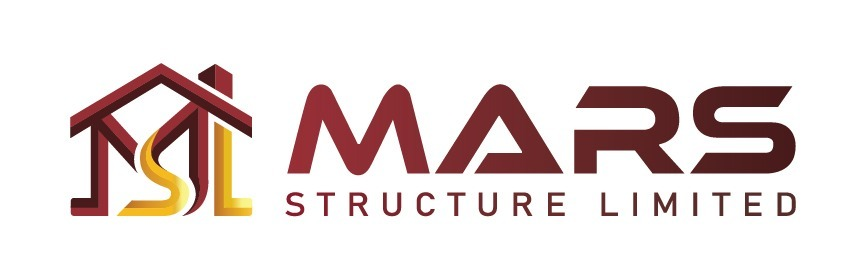

# MARS Structure Limited — Official Luxury Web Theme Template



> **Building Dreams • Creating Futures**  
> Premier single-unit luxury residential and commercial developments in Jolshiri Smart City, Narayangonj, Bangladesh.

---

## 🌟 Executive Overview

This repository houses the modern, high-performance web theme template for **MARS Structure Limited**. Built with responsive vanilla technologies (HTML5, Vanilla CSS, Vanilla JavaScript, Bootstrap 5, FontAwesome 6, and Leaflet Maps), the site provides a luxury real-estate experience matching international architectural standards.

### 🎨 Brand Identity & Design System
* **Royal Maroon / Deep Burgundy (`#7B1824`)**: Primary brand anchor, headers, accent buttons.
* **Imperial Gold (`#E5A922`)**: Metallic trims, active indicators, spec badges, and hover states.
* **Warm Alabaster (`#FAF7F2`)**: Editorial canvas background eliminating stark pure-white fatigue.
* **Burgundy Noir (`#14080B`)**: Deep contrast prestige footers, utility topbars, and hero canvases.
* **Curated Typography**: `Playfair Display` (editorial serif headings) + `Plus Jakarta Sans` / `Outfit` (clean geometric interface).

---

## 📁 Project Structure & Pages

```
├── index.html                  # Homepage (Interactive Hero, Signature Projects, Map, Testimonials)
├── about.html                  # About Us (Company Philosophy, Metrics Strip, Mission & Vision, Solutions, Office Hub)
├── properties.html             # Property Directory (Filterable: Ongoing, Upcoming, Completed)
├── property-details.html       # Landmark Showcase: Bayt-Al Noor (Video Modal, 4 Interactive Tabs, Floor Plan Lightbox)
├── contact.html                # Contact & VIP Inquiries (Direct Desks, Map, Appointment Form)
├── PROJECT_SPECIFICATION.md    # Detailed Architectural & Technical Blueprint
├── assets/
│   ├── css/                    # Bootstrap 5, FontAwesome, AOS, Leaflet, and custom style.css
│   ├── js/                     # Bootstrap bundle, AOS, Leaflet, and interactive main.js
│   ├── images/                 # Project renders, brochure spreads, floor plans, and logos
│   ├── videos/                 # Local HD video tour asset (bayt-al-noor-tour.mp4)
│   └── webfonts/               # Local FontAwesome WOFF2 font files
└── files/                      # Official downloadable architectural brochure PDFs
```

---

## 📱 Cross-Device Responsiveness Matrix

| Device / Viewport | Optimization Features |
| :--- | :--- |
| **Mobile & iOS** (`320px` - `767px`) | Safe area insets (`env(safe-area-inset-*)`), iOS 16px input zoom fix, zero horizontal overflow, touch-optimized minimum 44px tap targets, offcanvas drawer navigation. |
| **Tablet** (`768px` - `991px`) | Balanced 2-column layouts for metrics and service cards, centered visual collages, and fluid typography. |
| **Small Desktop** (`992px` - `1199px`) | Compact navigation spacing to prevent line-wrapping on 1024px and scaled 1366x768 screens, calibrated 4-column service grids. |
| **Large Desktop** (`1200px` - `1920px+`) | Full-width container breadth (up to 1320px), floating negative-margin stat bars, interactive watermark card animations. |

---

## 🚀 Local Preview & Deployment

1. **Local Preview**: Open any `.html` file directly in your browser or run a local static server:
   ```bash
   # Using Python
   python -m http.server 8080

   # Or using Node http-server / npx serve
   npx serve .
   ```
2. **GitHub Pages Deployment**:
   - Push this repository to GitHub.
   - Go to **Settings > Pages**.
   - Under **Build and deployment**, select **Deploy from a branch** and choose `main` / `root`.
   - Your site will be live instantly with zero build configuration needed.

---

## 📞 Management & Office Contacts
* **Head Office**: Plot 005, Road 409, Sector 11, Jolshiri Abashon, Narayangonj
* **Hotline**: `+880 1844 020600`
* **Email**: `info@marsstructureltd.com`
* **Official Website**: [https://marsstructureltd.com](https://marsstructureltd.com)

---
*© 2026 MARS Structure Limited. All rights reserved.*
